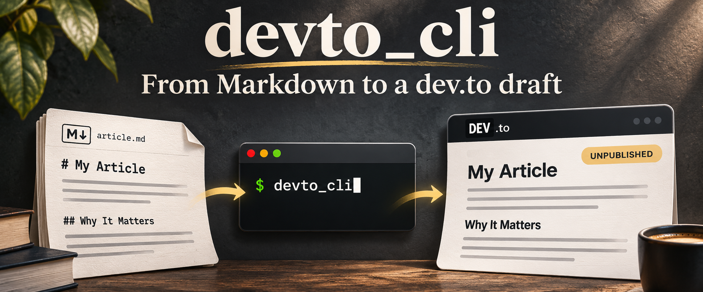

# From Markdown to a dev.to Draft with devto_cli

- Created: 17 November 2026
- Last updated: 17 November 2026
- Status: Local article draft for review; not uploaded or published
- Related framing: [Project instructions](../../../AGENTS.md)
- Related rules: [Documentation rules](../../../.agents/skills/docs_folder_system/SKILL.md)
- Related issue: [Technical article workflow, issue #3](https://github.com/jeromeetienne/devto_cli/issues/3)

*Writing about your code with a coding agent? Keep the article in your repository and let devto_cli carry the draft to dev.to.*



## The article is already beside the code

You finish a feature, ask your coding agent to explain the feature, and revise the explanation into an article. The Markdown file sits beside the source code, where examples and claims are easy to check. You can review the article changes with the same tools you use to review code.

Then comes the transfer to dev.to. Copy the text into the editor, add the title and tags, choose the cover, and repeat the transfer after the next revision. A script can send the article through the dev.to application programming interface, but somebody still has to handle authentication, construct requests, and interpret responses.

[devto_cli](https://github.com/jeromeetienne/devto_cli) puts those operations behind a small set of commands. A coding agent can read the local article, create a dev.to draft, and update the same article after you revise the text.

## Give the coding agent a repeatable workflow

The repository includes a [devto_cli skill](https://github.com/jeromeetienne/devto_cli/blob/main/skills/devto_cli/SKILL.md). A skill is a reusable set of instructions for a coding agent. The devto_cli skill explains authentication, article commands, output formats, and the need to ask before publishing or scheduling an article.

Once your coding agent has the skill available, the request can describe the writing task:

> Use devto_cli to create an unpublished dev.to draft from my local article Markdown file. Use the title and tags we agreed on. Report the article identifier and address. Ask before publishing or scheduling the article.

After reviewing the draft, you can ask:

> Update the same dev.to draft from the revised local article. Keep the article unpublished and report the result.

Keeping the article identifier matters: `create` makes a new article, while `update` changes an existing article. Revisions should use `update` so each revision does not become a separate draft.

## The details that make the workflow useful

Authentication happens once through `login`. The command checks the supplied dev.to application programming interface key against the account endpoint before saving the key. Later commands load the stored key automatically. `status` checks whether dev.to accepts the stored key, and `logout` deletes the local credential file.

The current implementation stores the key as plain text in `~/.config/devto_cli/credentials.json`, with file permissions restricted to the owner. The credential file belongs outside the repository; the credential file is not encrypted storage.

For article text, `--body-file` reads a Markdown file directly. Titles, tags, descriptions, series, canonical addresses, and cover images have separate options. This lets the article stay readable in the repository while publication settings remain explicit.

Images can stay local. The cover option accepts an image address or a local file, and inline images use ordinary Markdown image links. When `create` or `update` finds a local image file, devto_cli uploads the file to dev.to first, and replaces the local path with the hosted address. A relative image path in the article starts from the folder of the Markdown file.

Creating an article without publication options sends `published: false`. Publishing immediately requires `--publish`; scheduling requires `--publish-at` with a future date. The command rejects conflicting publication options and more than four tags. Updating an article without a publication option leaves the existing publication setting unchanged, so updating a published article does not automatically turn the article into a draft.

Article commands offer terminal text, a Markdown table, or structured JavaScript Object Notation output through `--format json`. Structured output lets a coding agent read the returned article identifier without extracting the identifier from coloured terminal text.

## What improves in practice

Consider an article with a first draft and two rounds of revisions. The intended sequence is one creation followed by two updates, all reading the local Markdown file. Authentication is reused, and each update targets the same remote article.

The practical gain is a repeatable transfer from reviewed local text to the dev.to draft. The local file can remain in version control, while the coding agent handles the command arguments and returned article details.

There is no timing benchmark behind this article. The commands and behaviour described here were checked against the repository implementation; this draft does not claim a measured time saving or a live account test. Comparing the remote draft with the local text remains a separate verification step.

## Start from the repository

For a source checkout, install the workspace dependencies and check the available commands from the repository root:

```bash
pnpm install
pnpm --filter devto_cli exec node --import tsx src/cli.ts --help
```

Ask your coding agent to read the repository's devto_cli skill and use the source checkout. Provide the dev.to key through your normal secret-handling process; keep the key out of article files, chat transcripts, and Git history.

For readers using the commands directly, this example creates an unpublished draft from a local file after login:

```bash
pnpm --filter devto_cli exec node --import tsx src/cli.ts create \
  --title "What I learned building this feature" \
  --body-file ../../article.md \
  --tags "typescript,writing" \
  --format json
```

The example assumes `article.md` is in the repository root. The workspace command runs inside `packages/devto_cli`, which explains the relative file path.

Review the returned article details and open the dev.to draft before publication. When the writing is ready, give your coding agent an explicit instruction to publish. The local article, the remote draft, and publication are three distinct steps that you can review separately.
